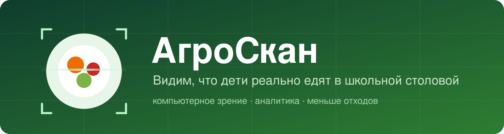
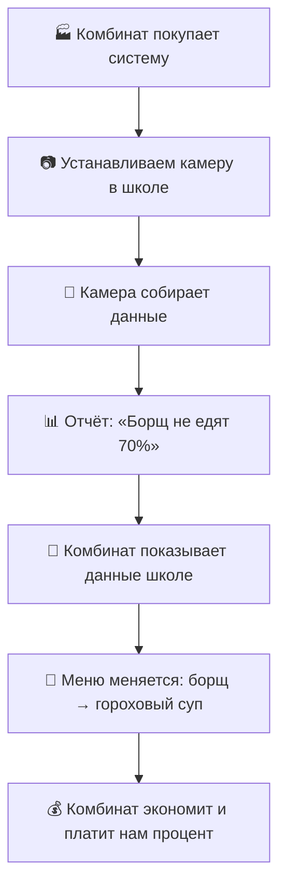

 

**Камера на линии подносов · нейросеть · отчёты для школы и комбината питания**

[О проекте](#о-проекте) · [Решение](#решение) · [Для кого](#для-кого) · [Бизнес-модель](#бизнес-модель) · [Технологии](#технологии) · [Roadmap](#roadmap)

---

## О проекте

**АгроСкан** - SaaS-платформа на базе компьютерного зрения и машинного обучения. Умная камера
сканирует подносы на линии раздачи и определяет, что ребёнок съел, а что оставил. Система собирает
статистику по блюдам и превращает её в понятные отчёты: какие блюда не едят, какие любят, что убрать из
меню и чем заменить.

> «Борщ не едят 70% детей. Плов едят 90%».

Мы - IT-компания: продаём технологию и данные, а не питание. Поэтому у нас нет юридических сложностей
оператора питания, а бизнес-модель прозрачна.

## Проблема

- В школьных столовых выбрасывается значительная часть еды (по оценкам, около 20% и больше).
- Меню составляют по нормативам, а не по реальным предпочтениям детей.
- У школы и комбината нет данных, чтобы обоснованно менять меню и закупки.
- Деньги на питание тратятся впустую, растёт число жалоб и проверок.

## Решение

| Шаг | Что происходит |
| --- | --- |
| 📷 **1. Камера** | Устанавливается на линии сбора подносов. Работает автоматически, без участия учителей и персонала |
| 🧠 **2. Нейросеть** | Распознаёт блюда на подносе и определяет, что осталось несъеденным |
| 📊 **3. Аналитика** | За неделю формирует отчёт: какие блюда не едят, какие любят |
| 🍲 **4. Решение** | Школа и комбинат меняют меню и закупки на основе данных |

**Результат:** дети едят то, что остаётся в меню; еда не выбрасывается; бюджет экономится; школа получает
отчёт для проверок; комбинат экономит на закупках.

## Для кого

### 🏭 Комбинат питания (оператор) - основной клиент

Коммерческая организация, которая кормит школы по контракту и заинтересована в снижении издержек.

- **Боль:** не может изменить заказ в одностороннем порядке - школа может не согласиться. Деньги теряются на
  продуктах, которые не съедены.
- **Что получает:**
  - 📉 **Экономия на закупках** - меньше продуктов уходит в мусор (20-30%)
  - 🤝 **Аргумент для школы** - «вот данные, дети не едят борщ, давайте заменим его на гороховый суп»
  - 🏆 **Преимущество в тендерах** - «у нас есть система анализа питания»
  - 🛡 **Меньше рисков** - меньше отходов, жалоб и проверок, контракт сохраняется
- **Монетизация:** подписка за одну школу (xxxxx руб./мес.) **или** 20% от сэкономленных средств.

### 🏫 Школа (директор или завхоз, отвечающий за питание)

- **Боль:** нет данных для изменения меню, решения принимаются по нормативам, а не по реальным
  предпочтениям детей. Неэффективное расходование средств может привести к штрафам.
- **Что получает:**
  - данные для обоснованных изменений меню
  - отчёт для проверок Роспотребнадзора и родительского контроля
  - меньше жалоб от родителей
  - рост KPI директора - эффективность расходования бюджета
- **Монетизация:** подписка на школу (xxxxx руб./мес.) из бюджета на питание или внебюджетных средств.

## Как это работает на практике

Комбинат не меняет заказ самовольно - он согласовывает изменения со школой. Наша система даёт ему
обоснование.

## Бизнес-модель

| Клиент | Модель | Ценность |
| --- | --- | --- |
| Комбинат питания | Подписка за школу **или** 20% от экономии | Меньше списаний, сильная позиция в тендерах |
| Школа | Подписка на школу | Отчёты для проверок, меньше жалоб |

Экономика строится на сокращении списаний продуктов и окупаемости подписки за счёт сэкономленных средств.

## Прототип

Рабочая основа - модуль распознавания еды по фото: дежурный повар фотографирует поднос, система
распознаёт блюда и считает остатки. Поверх него строим:

- мобильный и веб-интерфейс (кликабельный прототип в Figma + реализованные экраны);
- кабинет **директора школы** - отчёты по блюдам, отчёт для проверок;
- кабинет **комбината** - статистика, экономия, обоснование замены блюд.

## Технологии

| Слой | Стек |
| --- | --- |
| Распознавание | Компьютерное зрение, нейросеть для распознавания блюд |
| Клиент | React 18, Vite |
| Админка | React 18, Vite |
| Сервер | Node.js, Express, PostgreSQL |
| Мобильное приложение | Capacitor (iOS) |

## Структура репозитория

| Папка | Что внутри |
| --- | --- |
| 🌐 `web/` | веб-версия (сайт) |
| 🤖 `android/` | Android-версия |
| 🖥 `client/` | веб-приложение (текущая основа) |
| 🛠 `admin/` | панель администратора |
| ⚙️ `server/` | REST API |
| 📱 `mobile/` | мобильное приложение |
| 💬 `support/` | бот поддержки |
| 🎨 `assets/` | баннер и графика |

## Roadmap

- [x] Модуль распознавания еды по фото (основа)
- [x] Описание продукта и бизнес-модели
- [ ] Кабинет директора школы: отчёты по блюдам и для проверок
- [ ] Кабинет комбината: экономия и обоснование замены блюд
- [ ] Кликабельный прототип в Figma
- [ ] Веб-версия и Android-приложение
- [ ] Пилот в школе, защита проекта (**21.10.2026**)

## Команда

Проект выполняется для направления «Бизнес», срок сдачи - **21 октября 2026**.

---

**Бизнес - IT компания** · меньше отходов, больше пользы

