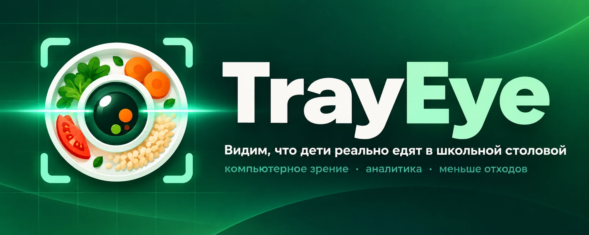
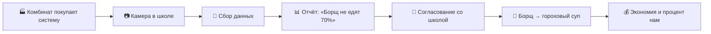

<div align="center">



<br><br>

**Камера смотрит на поднос. Нейросеть считает, что осталось. Школа и комбинат видят правду о меню.**

<br>

[](#roadmap)
[](#roadmap)
[](#как-это-работает)
[](#технологии)
[](#технологии)
[](#технологии)
[](LICENSE)

<br>

[**О проекте**](#-о-проекте) &nbsp;·&nbsp;
[**Как работает**](#-как-это-работает) &nbsp;·&nbsp;
[**Для кого**](#-для-кого) &nbsp;·&nbsp;
[**Бизнес-модель**](#-бизнес-модель) &nbsp;·&nbsp;
[**Технологии**](#-технологии) &nbsp;·&nbsp;
[**Roadmap**](#-roadmap)

</div>

<br>

> [!NOTE]
> «Борщ не едят 70% детей. Плов едят 90%». TrayEye превращает остатки на подносах в данные, по которым можно менять меню.

<br>

## 🌱 О проекте

**TrayEye** - SaaS-платформа на базе компьютерного зрения и машинного обучения. Умная камера сканирует
подносы на линии раздачи и определяет, что ребёнок съел, а что оставил. Система собирает статистику по
блюдам и превращает её в понятные отчёты: какие блюда не едят, какие любят, что убрать из меню и чем
заменить.

Мы IT-компания: продаём технологию и данные, а не питание. У нас нет юридических сложностей оператора
питания, а бизнес-модель прозрачна.

<table>
<tr>
<td width="50%" valign="top">

### 😞 Проблема

- В школьных столовых выбрасывается около **20%** еды и больше
- Меню составляют по нормативам, а не по реальным предпочтениям детей
- У школы и комбината нет данных, чтобы менять меню и закупки
- Деньги на питание тратятся впустую, растут жалобы и проверки

</td>
<td width="50%" valign="top">

### 😊 Решение

- Камера на линии подносов работает сама, без участия персонала
- Нейросеть распознаёт блюда и считает остатки
- За неделю формируется отчёт по каждому блюду
- Школа и комбинат меняют меню на основе цифр

</td>
</tr>
</table>

<br>

## 🔍 Как это работает

<table>
<tr>
<td align="center" width="25%">
<h3>📷</h3>
<b>1. Камера</b><br>
Стоит на линии сбора подносов. Работает автоматически
</td>
<td align="center" width="25%">
<h3>🧠</h3>
<b>2. Нейросеть</b><br>
Узнаёт блюда и определяет, что осталось несъеденным
</td>
<td align="center" width="25%">
<h3>📊</h3>
<b>3. Аналитика</b><br>
За неделю собирает отчёт: что едят, что нет
</td>
<td align="center" width="25%">
<h3>🍲</h3>
<b>4. Решение</b><br>
Меню и закупки меняются на основе данных
</td>
</tr>
</table>



Комбинат не меняет заказ самовольно: он согласовывает изменения со школой. Наша система даёт ему
обоснование.

<br>

## 👥 Для кого

<table>
<tr>
<td width="50%" valign="top">

### 🏭 Комбинат питания
**основной клиент**

Коммерческая организация, которая кормит школы по контракту и хочет снизить издержки.

**Боль:** не может изменить заказ в одностороннем порядке, а деньги теряются на несъеденных продуктах.

**Что получает**
- 📉 экономия на закупках 20-30%
- 🤝 аргумент для школы: «вот данные, давайте заменим борщ»
- 🏆 преимущество в тендерах
- 🛡 меньше жалоб, проверок и рисков для контракта

**Монетизация:** подписка за школу *или* 20% от сэкономленных средств

</td>
<td width="50%" valign="top">

### 🏫 Школа
**директор или завхоз, отвечающий за питание**

Решения о меню принимаются по нормативам, а не по предпочтениям детей.

**Боль:** нет данных для изменений, неэффективные расходы грозят штрафами.

**Что получает**
- 📋 данные для обоснованных изменений меню
- 🧾 отчёт для проверок Роспотребнадзора и родителей
- 💬 меньше жалоб от родителей
- 📈 рост KPI директора: эффективное расходование бюджета

**Монетизация:** подписка на школу из бюджета на питание или внебюджетных средств

</td>
</tr>
</table>

<br>

## 💼 Бизнес-модель

| Клиент | Модель | Ценность |
| :--- | :--- | :--- |
| 🏭 Комбинат питания | Подписка за школу **или** 20% от экономии | Меньше списаний, сильная позиция в тендерах |
| 🏫 Школа | Подписка на школу | Отчёты для проверок, меньше жалоб |

Экономика строится на сокращении списаний продуктов и окупаемости подписки за счёт сэкономленных средств.

<br>

## 🧪 Прототип

Работают оба кабинета (пока без финального дизайна, логика полностью):

- 🏫 **директор школы**: главная со списаниями, экономией и посещаемостью, прогноз порций на следующий
  учебный день, рекомендации, меню на день, классы и посещаемость, статистика по блюдам,
  загрузка фото подноса для распознавания нейросетью
- 🏭 **комбинат питания**: сводка по всем школам, «Меню товаров» (порции, вес, школы, поставщик),
  личные ссылки для директоров, каталог блюд и поставщики, статистика по школам и блюдам

Регистрации нет: комбинат создаёт **личную ссылку** с ФИО директора и номером школы, директор входит по ней.

<details>
<summary><b>🚀 Запуск локально</b></summary>

<br>

Нужны Node.js 20+ и PostgreSQL 16.

```bash
cp .env.example .env            # заполнить DATABASE_URL и JWT_SECRET
cd server && npm install
npm run seed                    # демо-данные + ссылки входа в консоль
npm run dev                     # API на :4100

cd ../web && npm install
npm run dev                     # интерфейс на :5173, открыть ссылку из seed
```

Для продакшена: `cd web && npm run build`, после чего `server` сам раздаёт `web/dist` на том же порту.
Распознавание подносов включается ключом `GEMINI_API_KEY` (бесплатно) или `OPENAI_API_KEY`.

</details>

<details>
<summary><b>📐 Как считаются цифры</b></summary>

<br>

| Показатель | Формула |
| :--- | :--- |
| Списания | (заказано - съедено) × цена / заказано × цена; съедено = Σ(1 - остаток) по подносам |
| Было | списания за первые 5 учебных дней с данными (до перехода на прогноз) |
| Экономия | (было - сейчас) × сумма заказа за день |
| Прогноз | ожидаемая явка (тот же день недели, 4 недели) × доля взявших блюдо × поправка дня недели + 3% |
| Рекомендации | день недели, когда едят меньше; блюда, которые берут ≤ 60% детей или оставляют ≥ 35% |

Код: `server/src/services/metrics.js`.

</details>

<br>

## ⚙️ Технологии

| Слой | Стек |
| :--- | :--- |
| 🧠 Распознавание | Gemini (бесплатный тир) → OpenAI как резерв: фото подноса → блюда и остатки |
| 🖥 Веб-платформа |   |
| ⚙️ Сервер |    |
| ✅ Тесты | Jest + Supertest (API на настоящем Postgres), Vitest |

<details>
<summary><b>📁 Структура репозитория</b></summary>

<br>

| Папка | Что внутри |
| :--- | :--- |
| 🌐 `web/` | веб-платформа: кабинеты директора и комбината |
| ⚙️ `server/` | REST API, схема БД, демо-данные, тесты |
| 🎨 `assets/` | баннер и графика |
| 📚 `docs/` | документация и план |

</details>

<br>

## 🗺 Roadmap

- [x] Модуль распознавания еды по фото (основа)
- [x] Описание продукта и бизнес-модели
- [x] База данных: школы, классы, каталог блюд, меню, посещаемость, сканы подносов
- [x] Вход по личной ссылке без регистрации
- [x] Кабинет директора школы: списания, экономия, прогноз, рекомендации, меню, классы, статистика
- [x] Кабинет комбината: школы и ссылки, меню товаров, поставщики, статистика
- [x] Кликабельный прототип в Figma
- [ ] Дизайн экранов по макету Figma
- [ ] Отчёт для проверок Роспотребнадзора
- [ ] Демо на сервере
- [ ] Пилот в школе и защита проекта - **21 октября 2026**

<br>

## 🤝 Участие в проекте

[Как работать с репозиторием](CONTRIBUTING.md) &nbsp;·&nbsp; [Кодекс поведения](CODE_OF_CONDUCT.md) &nbsp;·&nbsp;
[Безопасность](SECURITY.md) &nbsp;·&nbsp; [Документация](docs/README.md) &nbsp;·&nbsp; [Лицензия](LICENSE)

Проект выполняется для направления «Бизнес», срок сдачи - **21 октября 2026**.

<br>

---

<div align="center">

**TrayEye** &nbsp;·&nbsp; меньше отходов, больше пользы 🌱

</div>
